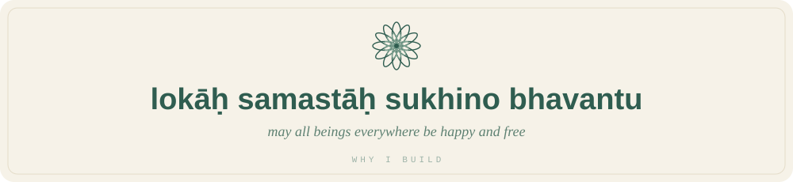
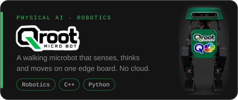
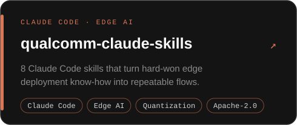
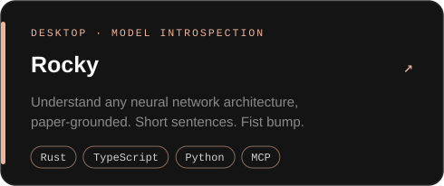
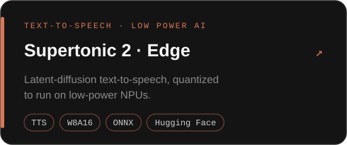
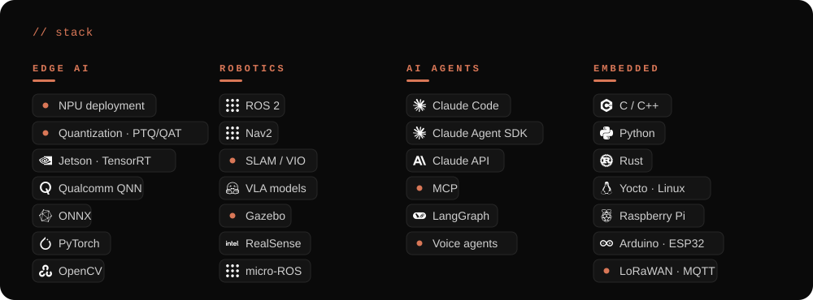

<!-- Visuals live in assets/ and are generated by scripts/gen_assets.py
     Katana photo: "Blades and Mountings for a Pair of Swords (Daishō)", The Metropolitan Museum of Art, CC0 (via Wikimedia Commons).
     Logos: Simple Icons, CC0. -->

  

  
  
  
  
  
  

  

I build intelligent machines. My work sits where AI meets robotics, embedded systems and real hardware: taking models out of the cloud and turning them into systems that can see, understand and act. I'm hooked on the hard part of **Physical AI**, making intelligence work reliably on real hardware.

- 🔧 **Physical AI & Robotics Lead**: edge AI, VLAs, vision and speech on real hardware [⭐](https://nunnarilabs.com)
- 🚀 **Entrepreneur**, building a deep-silicon & robotics startup [⭐](https://www.linkedin.com/company/raemox/)
- 🌏 **Community Lead** at AI Tamil Nadu, taking AI beyond the metros [⭐](https://aitamilnadu.org/)
- 🎤 **Speaker & mentor** on Physical AI, world models, VLAs and edge NPUs, often in Tamil

  

<table align="center">
  <tr>
    <td width="50%"></td>
    <td width="50%"></td>
  </tr>
  <tr>
    <td width="50%"></td>
    <td width="50%"></td>
  </tr>
</table>

  

<table align="center">
  <tr>
    <td width="50%"></td>
    <td width="50%"></td>
  </tr>
</table>

  

  

  

